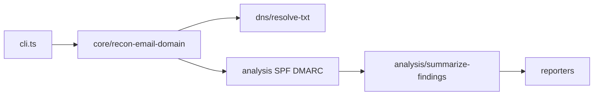

# hx-email-recon-cli — architecture

## Purpose

Resolves email-related DNS records for a domain, analyzes SPF/DMARC policy strings,
probes known DKIM selector names, and emits ranked findings. Non-goals: sending mail,
mailbox brute force, or DMARC aggregate report ingestion.

## High-level flow

## Module map

| Path                                 | Responsibility                          |
| ------------------------------------ | --------------------------------------- |
| `src/cli.ts`                         | Commander `recon`, `--json`, exit codes |
| `src/core/recon-email-domain.ts`     | Orchestrate lookups and analysis        |
| `src/dns/resolve-txt.ts`             | TXT queries (mockable in tests)         |
| `src/analysis/analyze-spf.ts`        | SPF record heuristics                   |
| `src/analysis/analyze-dmarc.ts`      | DMARC policy heuristics                 |
| `src/analysis/summarize-findings.ts` | Severity rollup                         |
| `src/constants/dkim-selectors.ts`    | Selector list to probe                  |
| `src/reporters/`                     | JSON and table formatters               |
| `src/email.ts`                       | Barrel export for library use           |

## Extension

1. Add a selector in `dkim-selectors.ts` or load from a config file.
2. Add an analyzer module and wire into `recon-email-domain.ts`.
3. Mock DNS in unit tests; reserve live DNS for integration config.
4. Run `npm test` and `npm run format:check`.

## Testing strategy

- **Unit**: SPF/DMARC parsers, summarize, DNS resolver mocks (`*.spec.ts`).
- **Integration**: `jest.integration.config.js` — live TXT against public domains.

## Ethics & scope

Authorized engagements only. See [SECURITY.md](./SECURITY.md).
